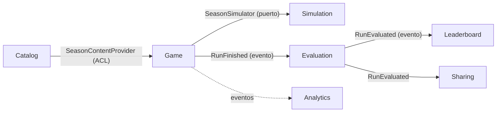

# Míster Histórico: Plan de implementación

> Fecha: 2026-10-22 · Parte de [`PRODUCT_BRIEF.md`](./PRODUCT_BRIEF.md) · Las tareas están en [`TASKS.md`](./TASKS.md).
> Estado: **plan aprobado** (2026-10-22). **F1 cerrada el 2026-10-23** tras integrar la PR #17 por rebase-merge, con calibración provisional y limitaciones aceptadas. [Registro de cierre y checks](HANDOFF.md#3-estado-comprobado-f1-cerrada). **F2 no iniciada.** Las secciones §1 y §2 recogen las decisiones del autor.

---

## 1. Decisiones cerradas (respuestas del autor a §19 del brief)

| # | Decisión | Resultado |
|---|---|---|
| 2 | Nombres de jugadores | **Reales, pero desactivables.** Cada jugador tiene `display_name` (el real) y `alias_name`. Una política de nombres (`NamePolicy`) en la capa de presentación decide cuál se muestra según un flag. El dominio solo trabaja con IDs. |
| 3 | Equipos V1 | **Real Madrid 2012-13, FC Barcelona 2008-09, Atlético 2013-14, Valencia 2003-04 y Sevilla 2005-06.** Orden de producción: RM (es el piloto que valida el pipeline), Barça, Atleti, Valencia y Sevilla. Si falta tiempo, se lanza con los tres primeros. |
| 4 | Medias | **Escala 1-99 con una fórmula propia como base**, a partir de estadísticas públicas de esa temporada (minutos, titularidades, goles, porterías a cero de los porteros, internacionalidades, premios y nivel del club), con fuente para cada dato. Las asistencias son informativas y no entran en el cálculo. Los jugadores clave (6-10 por plantilla) se **revisan siempre a mano** y pueden llevar una corrección con evidencia y fuentes (hasta ±12). La fórmula sola no capta bien a algunas estrellas: la revisión es parte esencial del procedimiento. El autor ha elegido el **cierre provisional de la calibración con sus limitaciones explícitas** (opción 1 del traspaso, 2026-10-23): el umbral de participación del 85 % y el tope manual de 94 sin premio mundial individual son parámetros provisionales, pendientes de validación con plantillas completas en F2. No se copian medias de juegos comerciales. |
| — | Calibración | Banda del triplete del Barça 2008-09: **5-15 %**, sin excepciones a la regla general (mínimo 5 %). No hay `calibration_overrides` en el esquema. |
| — | Jugadores de referencia de la rúbrica | **Elegidos por el orquestador por delegación del autor.** Las 24 anclas, sus posiciones reales y las bandas están en la [rúbrica, §9](content/rating-rubric.md#9-calibración-de-la-fórmula); los resultados y las limitaciones están en el [informe](calibration/anchors.md). Elección y revisión completadas; F1 cerrada con aceptación provisional tras integrar la PR #17 y superar sus comprobaciones. El hueco de posición declarado no se cubre con datos inventados. |
| — | Rivales | **Con plantilla real desde la V1** (antes era la propuesta P1, que se ha descartado). La plantilla pertenece a un `ClubSeason` (club + temporada), compartido entre tu equipo y los rivales. Es la base del mercado de fichajes: fichar a un jugador de un rival lo saca de la plantilla de ese rival dentro de tu partida. Los rivales de fuera de Primera, como los de las primeras rondas de Copa, usan una fuerza agregada por falta de datos fiables. |
| 5 | Frontend | **React + Vite + TypeScript** (estricto). |
| 6 | Hosting | **Se decide más tarde** (tarea T7.1). Hasta entonces, todo va en Docker portable y sin depender de ningún proveedor. |
| 7 | Simulación | **Poisson con fuerza de ataque y defensa**, detrás de un puerto `GoalModel` para poder cambiar a Dixon-Coles sin tocar el resto. |
| 8 | IA en V1 | **Solo contenido offline**, con revisión humana obligatoria. Coste cero por partida. |
| 9 | Repo | **Público desde el primer día.** El historial de commits demuestra el TDD. |
| 1 | Nombre y dominio | Sigue abierto. No bloquea nada: se usa `mister-historico` como nombre técnico. |

## 2. Decisiones de diseño (propuestas por el plan y confirmadas por el autor)

Todas las propuestas, de P2 a P6, están confirmadas. P1 se descartó.

- ~~**P1. Rivales con fuerza agregada.**~~ **Descartada:** los rivales tienen plantilla (ver §1).
- **P2. "La historia real es el rival", también en la simulación.** Los partidos que no te involucran no se simulan: se usan sus resultados históricos.
  - *Liga:* puntos de un rival = puntos reales − los que sacó contra ti en la realidad + los que saca contra ti en la simulación. Solo hace falta la clasificación real en las fechas de corte de cada bloque y los resultados de tu equipo.
  - *Eliminatorias:* se usa el cuadro real. Si llegas más lejos que en la realidad, te enfrentas al rival que de verdad ganó esa eliminatoria.
  - *Cómo encaja con las plantillas rivales:* en la V1, fichar a un jugador de un rival solo debilita a ese rival en los partidos contra ti. La política va detrás del puerto `ExternalResultsPolicy`, con el adaptador `HistoricalExternalResults` en la V1. Más adelante, cuando haya un mercado completo, se añadirá `SimulatedExternalResults`, que simulará todos los partidos con las plantillas rivales. Esa opción necesitará el calendario completo de la liga.
- **P6. Medias de los rivales con un procedimiento ligero.** Las plantillas rivales solo incluyen a los jugadores con minutos relevantes esa temporada (entre 18 y 22 por equipo). Los jugadores clave (`key: true`) se revisan a mano y solo se corrigen con un `rating_override` justificado. La comprobación principal es de conjunto: la fuerza que resulta de la plantilla de cada rival tiene que corresponderse con sus goles a favor y en contra reales, dentro de una banda. Eso se comprueba en la calibración.
- **P3. Código en inglés, interfaz en español.** Un glosario (`docs/glossary.md`) traduce el lenguaje ubicuo: Partida = `Run`, Míster = `Manager`, Bloque = `Block`, Dilema = `Dilemma`, Directiva = `Board`, etc.
- **P4. Licencias.** MIT para el código y CC BY-NC 4.0 para los datos de contenido (las fuentes se citan).
- **P5. Datos de prueba sintéticos.** Los tests unitarios y de aplicación usan un equipo ficticio ("Test FC 2000-01") y nunca datos históricos reales. Lo real solo se usa en los tests de contenido y de calibración. Así nadie se ve tentado a inventar datos para que pase un test.

---

## 3. Arquitectura

### 3.1 Contextos delimitados (DDD)

| Contexto | Tipo | Responsabilidad | Modelo principal |
|---|---|---|---|
| **Catalog** (Catálogo histórico) | Soporte | Contenido histórico versionado: clubes, temporadas, plantillas, medias, calendario, dilemas, textos e historia real. Solo lectura en tiempo de juego. | `ClubSeason` (club + temporada + plantilla, se use como equipo propio o como rival), `PlayableSeason` (un `ClubSeason` jugable, con su entrenador real, su historia real, sus dilemas y sus objetivos), `PlayerSeason`, `Competition`, `Fixture`, `HistoricalOutcome`, `Dilemma`, `Effect` |
| **Simulation** (Motor) | **Núcleo** | Simula partidos, competiciones y bloques de forma determinista a partir de una semilla. No hace IO. | `GoalModel`, `TeamStrength`, `MatchResult`, `LeagueTable`, `KnockoutTie`, `BlockSimulation` |
| **Game** (Partida) | **Núcleo** | El agregado `Run`: estado de la temporada, decisiones, efectos, moral, estado físico, confianza de la directiva y destitución. También guarda los cambios en las plantillas rivales (fichajes y ventas) como diferencias sobre el contenido. | `Run`, `RunState`, `SquadRegistry`, `Decision`, `BoardConfidence`, `Morale` |
| **Evaluation** (Evaluación) | Núcleo | Puntuación del míster (0-100), comparación con la historia y veredicto. | `MisterScore`, `HistoricalComparison`, `Verdict` |
| **Leaderboard** (Ranking) | Soporte | Ranking por temporada con alias y percentiles. | `LeaderboardEntry`, `Alias`, `Percentile` |
| **Sharing** (Compartir) | Soporte | Tarjeta para compartir (imagen OG), página pública `/r/<id>`. | `ShareCard` |
| **Analytics** | Genérico | Eventos de producto sin cookies. | `ProductEvent` |

**Mapa de contextos:**



- **Catalog → Game:** el contenido se publica como DTOs de solo lectura (*published language*). Game lo traduce a su modelo con un adaptador que hace de ACL.
- **Game → Simulation:** Game depende de un puerto `SeasonSimulator`. El adaptador traduce `RunState` al modelo de entrada del motor. El motor no sabe nada de partidas, dilemas ni HTTP.
- **Eventos de dominio** en proceso (un bus síncrono en la V1) para el final de partida: evaluar, hacer elegible para el ranking y registrar la analítica.

### 3.2 Arquitectura hexagonal: capas y reglas

```
backend/src/mister/
  shared_kernel/              # IDs tipados, Seed, RandomSource, Clock, DomainError, DomainEvent
  <contexto>/
    domain/                   # entidades, VOs, servicios de dominio, eventos. Python puro (dataclasses).
    application/              # casos de uso (commands/queries), puertos (typing.Protocol), DTOs
    infrastructure/           # adaptadores: sqlalchemy, yaml, pillow, redis...
  entrypoints/
    api/                      # FastAPI: routers por contexto, mapeo de errores a problem+json
    cli/                      # typer: content validate/load, calibrate, replay
  bootstrap.py                # composition root: cablea puertos y adaptadores
```

**Reglas obligatorias, comprobadas en CI con `import-linter`:**

1. `domain` solo importa la biblioteca estándar y `shared_kernel`. **Nada** de FastAPI, SQLAlchemy, Pydantic ni Redis.
2. `application` importa `domain` y define los puertos. No importa `infrastructure`.
3. `infrastructure` implementa los puertos. No la importa nadie salvo `bootstrap.py`.
4. Un contexto no importa el `domain` de otro. Solo puede usar su **API publicada** (`<contexto>/application/api.py`: DTOs y fachada), y siempre desde un adaptador de su `infrastructure`.
5. `entrypoints` solo llama a casos de uso de `application`.

**Frontend** (`frontend/src/`), con hexagonal ligera comprobada con `dependency-cruiser`:

```
domain/          # view models y funciones puras (formatear resultados, narrativa de bloque...)
application/     # hooks de casos de uso (useStartRun, useTakeDecision...) sobre puertos. Pueden usar TanStack Query
infrastructure/  # adaptadores: cliente API generado desde OpenAPI, analítica
ui/              # componentes y pantallas. Solo usan application/ y domain/
app/             # composition root: rutas, providers y cableado de puertos con adaptadores. Es lo único que importa infrastructure/
```

### 3.3 Decisiones técnicas clave (cada una tendrá su ADR en `docs/adr/`)

| ADR | Tema | Propuesta |
|---|---|---|
| 001 | Monorepo y stack | `backend/` (Python 3.12, uv, FastAPI, SQLAlchemy 2, Alembic, Postgres 16), `frontend/` (React, Vite, TS), `content/` (YAML), `tools/`, `infra/`. |
| 002 | Capas hexagonales y su verificación | Lo de §3.2, con `import-linter` y `dependency-cruiser`. |
| 003 | Contextos delimitados | El mapa de §3.1. |
| 004 | Modelo de goles | Goles ~ Poisson(λ), con λ = base_liga × ataque_propio × defensa_rival × factor_local × ajustes (táctica, moral, estado físico). Va detrás del puerto `GoalModel`. |
| 005 | Determinismo | `RandomSource` con **flujos derivados**: `stream(seed, "match", fixture_id)`. Cada partido usa su propio flujo, así que una decisión tomada en el bloque 2 no altera el azar de partidos que no dependen de ella. Misma semilla y mismas decisiones dan exactamente el mismo resultado. **Implementación en Python puro** sobre `random.Random(int).random()`, cuya secuencia está garantizada entre versiones de Python; Poisson y demás distribuciones se implementan en el proyecto. No se usa numpy, que no garantiza la estabilidad de sus distribuciones entre versiones (rompería los golden tests y el replay). |
| 006 | Medias 1-99 | La rúbrica está en `docs/content/rating-rubric.md`. La media de cada jugador se calcula a partir de sus `season_stats` (con `sources`). |
| 007 | Contenido como datos | `content/clubs/<club>.yaml` (nombre y colores), `content/club-seasons/<club>-<temporada>/squad.yaml` (plantilla, un directorio por cada club y temporada, sea propio o rival) y `content/seasons/<slug>/` (lo jugable: temporada, calendario, clasificaciones, dilemas y textos, que referencian club-seasons). Esquema Pydantic que también se exporta como JSON Schema. `mister content validate` en CI. `mister content load` es idempotente y usa un hash de la versión de contenido. |
| 008 | Nombres reales desactivables | `NamePolicy` en la presentación, controlada por un flag de entorno. |
| 009 | Persistencia de la partida | Snapshot del `RunState` en JSONB más un log de decisiones. **Replay:** el estado se puede reconstruir a partir de la semilla y las decisiones, y se usa como test y como antitrampas. Bloqueo optimista por `version`. |
| 010 | Tarjeta OG | Se renderiza en el servidor con Pillow (1200×630), con URL inmutable `/og/<run_id>.png` cacheable en el CDN. `/r/<id>` es HTML renderizado en el servidor con las meta OG/Twitter, porque los crawlers no ejecutan la SPA. |
| 011 | Frontend | TanStack Query para el estado de servidor, sin store global. Tailwind. Presupuesto: < 100 KB gz de JS inicial y Lighthouse móvil ≥ 90. |
| 012 | Hosting | Se decide en F7. |
| 013 | IA offline | `tools/content-gen` genera borradores con estado `draft`. Solo se cargan los textos con `reviewed_by`. El coste de cada ejecución queda registrado. Se usa una API key personal (§20 del brief). |
| 014 | Puntuación del míster | Fórmula de `MisterScore` (0-100): títulos con peso por competición, puntos en liga frente a los reales, moral y objetivos. Pesos configurables. Lo redacta T5.1. |
| 015 | `ClubSeason` frente a `PlayableSeason` | La plantilla pertenece al `ClubSeason`, de modo que tu equipo y los rivales comparten modelo. En una partida, la plantilla efectiva es la del contenido más las diferencias guardadas en `SquadRegistry` (fichajes y ventas). Es la base del mercado de fichajes y permite que cualquier rival sea jugable más adelante. |

---

## 4. Estrategia de testing y TDD

### 4.1 Ciclo obligatorio para cada tarea

1. **Rojo:** escribir el test que falla. Commit `test(<ctx>): <comportamiento>`.
2. **Verde:** el código mínimo para que pase. Commit `feat(<ctx>): ...`.
3. **Refactor:** con los tests en verde. Commit `refactor(<ctx>): ...`.

Las PR se integran con **rebase-merge, no con squash**, para que la secuencia rojo → verde → refactor se vea en el historial público. La CI solo se ejecuta sobre el HEAD de la PR, así que los commits intermedios en rojo no rompen nada.

### 4.2 Pirámide de tests

| Nivel | Qué cubre | Herramientas | Cuándo se ejecuta |
|---|---|---|---|
| Unitario de dominio | Entidades, VOs, servicios de dominio. Sin IO. Con propiedades (Hypothesis) para el motor y los efectos. | pytest, hypothesis | Cada push |
| Aplicación | Casos de uso con adaptadores **fake en memoria** (nada de mocks por defecto). | pytest | Cada push |
| Contrato de puertos | **Una sola suite por puerto**, que se ejecuta contra el fake y contra el adaptador real. Garantiza que el fake no miente. | pytest y testcontainers (Postgres, Redis) | Cada push |
| API | Routers, mapeo de errores y conformidad con OpenAPI. | httpx AsyncClient | Cada push |
| Contenido | Esquema, integridad referencial, fuente en cada dato histórico y medias dentro de la rúbrica. | `mister content validate` | Cada push que toque `content/` |
| Calibración | Monte Carlo (≥ 10 000 temporadas por equipo) jugando con la "política histórica". Comprueba que la realidad cae dentro de las bandas esperadas. | pytest `-m calibration` | Cambios en `simulation/` o en `content/`, y cada noche |
| Golden / replay | Una semilla fija y una lista de decisiones dan un resultado exacto, guardado como fichero dorado. | pytest | Cada push |
| Mutación | Dominio de `simulation` y `evaluation`. | mutmut | Cada noche (umbral ≥ 80 %) |
| Frontend unitario y de componentes | `domain/`, hooks y componentes. | Vitest, Testing Library, MSW | Cada push |
| E2E | El bucle completo en un viewport móvil, primero con MSW y después con el backend real. | Playwright | Cada PR |
| Carga | La partida completa, ráfagas de `/r/` y de `/og/`. | k6 | Antes del lanzamiento y a demanda |

### 4.3 Umbrales en CI (bloqueantes)

- Cobertura de `domain` + `application` en el backend: ≥ 95 % de líneas y ramas. Global: ≥ 85 %.
- Cobertura de `domain` + `application` en el frontend: ≥ 90 %.
- `mypy --strict`, `ruff`, `import-linter`, `eslint`, `tsc --noEmit` y `dependency-cruiser` en verde.
- El OpenAPI que genera FastAPI tiene que coincidir con `contracts/openapi.yaml` (contract-first). El cliente TypeScript se regenera, y si hay diferencias falla la CI.

### 4.4 Reglas de tests para los agentes

- Fakes antes que mocks. Un mock solo se usa para comprobar una interacción saliente en un borde, como un evento publicado.
- Un comportamiento por test. El nombre del test describe la regla de negocio, por ejemplo `test_manager_is_sacked_when_board_confidence_drops_below_threshold`.
- Prohibido escribir datos históricos reales en los tests unitarios: se usa `Test FC` (P5).
- Prohibido el azar sin semilla: todo test que use azar recibe un `RandomSource` con semilla.

---

## 5. Fases

Cada fase termina en una **puerta de calidad (gate)**: unos criterios que tienen que cumplirse antes de dar la fase por cerrada. Hay cuatro **tracks** que avanzan en paralelo (backend, contenido, frontend y plataforma), así que las fases se solapan. La que bloquea a las demás es la F1 (contratos).

```mermaid
gantt
  dateFormat X
  axisFormat %s
  section Plataforma
  F0 Fundaciones           :f0, 0, 1
  F7 Producción y lanzamiento :f7, 7, 9
  section Backend
  F1 Contratos             :f1, 1, 2
  F2 Motor + Catálogo      :f2, 2, 4
  F3 Partida + API         :f3, 4, 5
  F5 Final y viralidad     :f5, 5, 7
  section Contenido
  F2 Real Madrid 2012-13 (piloto) :c1, 2, 4
  F6 Resto de equipos + textos IA :c2, 4, 8
  section Frontend
  F4 Bucle completo (MSW → API real) :fe, 2, 6
```



*(El eje está en "unidades de trabajo" relativas, no en semanas: el ritmo real lo marca tu tiempo de revisión.)*

| Fase | Objetivo | Gate de salida |
|---|---|---|
| **F0 Fundaciones** | Repo, tooling, CI, Docker de desarrollo, convenciones y ADR base. | La CI está en verde con el esqueleto, `import-linter` rechaza una violación de prueba y existe `CLAUDE.md` con las reglas. |
| **F1 Contratos** | El shared kernel, el esquema de contenido, los puertos con sus fakes y suites de contrato, OpenAPI v0 y la rúbrica de medias. | Contratos **congelados**: a partir de aquí, los agentes de distintos tracks ya no se pisan. Rúbrica aprobada por el autor, con fórmula base y revisión manual de claves. El cierre provisional autorizado no equivale a superar las bandas de las anclas: exige datos corregidos, limitaciones publicadas, revisión independiente y comprobaciones en verde antes de integrar la PR #17. **Gate cumplido el 2026-10-23**; evidencia en [HANDOFF](HANDOFF.md#3-estado-comprobado-f1-cerrada). |
| **F2 Motor + Catálogo + Piloto** | El motor completo y calibrado, el catálogo con carga a la base de datos, y el RM 2012-13 completo y verificado, **incluidas las plantillas de sus rivales**. | Calibración del RM en verde (también la fuerza de cada rival frente a sus goles reales) y contenido del RM firmado por el autor. |
| **F3 Partida + API** | El agregado `Run`, los efectos, la directiva y la moral, la persistencia, los casos de uso y la API. | Una partida completa del RM se juega por HTTP en un test E2E, el replay es determinista y el golden test está en verde. |
| **F4 Frontend** | El bucle completo en móvil (selección, bloques, decisiones y final). Empieza contra MSW. | El E2E de Playwright pasa contra el backend real. Lighthouse móvil ≥ 90 y JS < 100 KB gz. |
| **F5 Final y viralidad** | Evaluación, veredicto, tarjeta OG, `/r/<id>`, ranking y percentil. | Una partida terminada genera puntuación, veredicto, una tarjeta válida (comprobada con un validador de meta tags) y una entrada en el ranking. |
| **F6 Contenido completo** | Los cuatro equipos restantes, los textos con IA offline revisados, el equilibrio entre equipos y la auditoría legal. | Los 5 equipos están validados, calibrados y firmados. Una partida dura entre 3 y 5 minutos (medido en la beta interna). |
| **F7 Producción y lanzamiento** | Hosting, observabilidad, analítica, endurecimiento, prueba de carga, despliegue, README de portfolio, beta y lanzamiento. | Se alcanza el objetivo de carga, hay backups probados, el README está publicado, se ha hecho la beta y se ha lanzado. |

**Camino crítico:** F0 → F1 → F2 (motor + catálogo + contenido del RM) → F3 → F5 → F7.
**El riesgo principal está en los datos** (brief §13): el track de contenido empieza en cuanto cierra la F1 y no para hasta la F6.

Con las plantillas rivales, el volumen de datos es de unos 30 `ClubSeason` por cada temporada jugable: en total, unas 150 plantillas y entre 3 500 y 4 000 jugadores. Cada plantilla rival es un directorio independiente, así que hay mucho paralelismo posible: un agente por cada grupo de entre 3 y 5 clubes. El cuello de botella es tu revisión, no los agentes. Si hace falta recortar, la palanca es **lanzar con 3 equipos** (RM, Barça y Atleti), no quitar las plantillas rivales.

---

## 6. Cómo trabajan los agentes en paralelo

1. **Una tarea es un agente, un *git worktree* o rama (`task/T2.3-league`) y una PR.**
2. **Propiedad de ficheros.** Cada tarea declara en `TASKS.md` los directorios que le pertenecen. Un agente no toca ficheros que no son suyos. Si necesita cambiar un contrato (puerto, esquema u OpenAPI), **para y abre una tarea de cambio de contrato (CR)**, que se integra primero.
3. **Oleadas.** Dentro de cada fase, las tareas de la misma oleada (A, B, C…) no dependen entre sí y pueden ir a la vez. Lo recomendable es tener entre 3 y 5 agentes simultáneos, para que puedas revisar lo que producen.
4. **Ficheros compartidos** (`pyproject.toml`, `package.json`, workflows de la CI y `bootstrap.py`): solo los modifica la tarea que los creó o una tarea CR. Si una tarea necesita una dependencia nueva, la pide en la descripción de la PR.
5. **Revisión.** Cada PR pasa la CI y una revisión independiente (un agente revisor sin el contexto del autor, por ejemplo `/code-review`) antes de integrarse. Las tareas **[HUMANO]** las cierras tú.
6. **Contenido histórico:**
   - El **agente investigador** escribe los datos con una fuente para cada uno. Si no encuentra un dato, deja `null` y `verify: pending`, y la validación en modo release falla. **Nunca inventa.**
   - Un **agente verificador independiente** (que no ve las notas del investigador, solo el YAML y la web) contrasta cada dato y genera un informe de discrepancias.
   - **Tú firmas** (`reviewed_by` en el fichero).
7. **Prompt base para cada agente:** *"Lee `CLAUDE.md`, `docs/PLAN.md` §3-4, los ADR relevantes y la tarea `<ID>` de `docs/TASKS.md`. Trabaja solo en los ficheros que te pertenecen. Sigue el ciclo TDD de §4.1 con commits separados. Termina cuando cumplas todos los criterios de aceptación y la CI esté en verde."*
