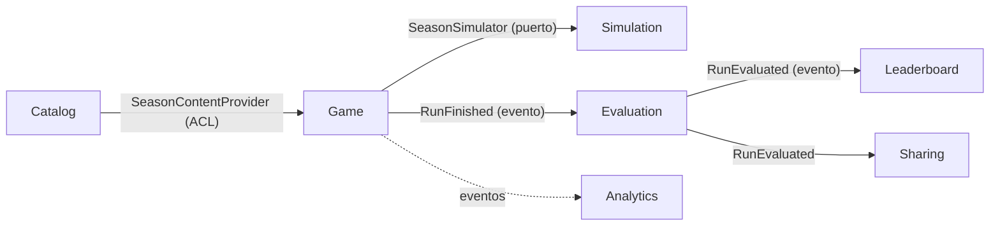
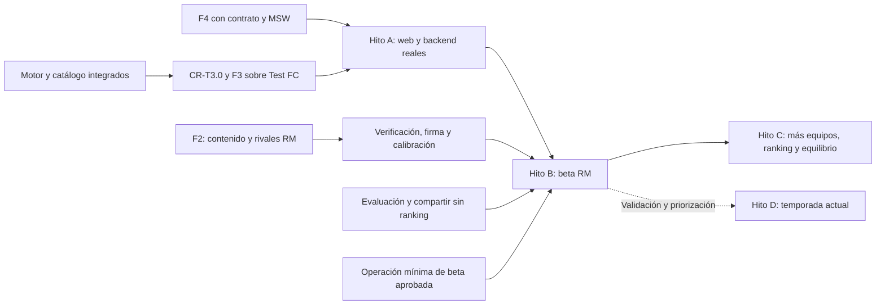

# Míster Histórico: Plan de implementación

> Fecha: 2026-10-22 · Parte de [`PRODUCT_BRIEF.md`](./PRODUCT_BRIEF.md) · Las tareas están en [`TASKS.md`](./TASKS.md).
> Estado comprobado el **2026-10-28**, tras integrar las PR #61/#62: motor y catálogo, estado y agregado Game, captura recuperable, persistencia SQL de runs y shell/adaptador web integrados con revisión Sol y CI. Efectos, directiva y moral también están integrados; siguen pendientes los casos de uso/API de partida y pantallas del bucle; F2 histórica permanece abierta. No hay todavía una primera partida completa ni beta. El lanzamiento V1 de 3-5 equipos se mantiene y las decisiones de beta siguen en §5.4.

---

## 1. Decisiones cerradas (respuestas del autor a §19 del brief)

| # | Decisión | Resultado |
|---|---|---|
| 2 | Nombres de jugadores | **Reales, pero desactivables.** Cada jugador tiene `display_name` (el real) y `alias_name`. Una política de nombres (`NamePolicy`) en la capa de presentación decide cuál se muestra según un flag. El dominio solo trabaja con IDs. |
| 3 | Equipos V1 | **Real Madrid 2012-13, FC Barcelona 2008-09, Atlético 2013-14, Valencia 2003-04 y Sevilla 2005-06.** Orden: RM, Barça, Atleti, Valencia y Sevilla; lanzamiento con los tres primeros si falta tiempo. Se propone una **beta anterior con solo RM** (§5), sin cambiar esta decisión sobre el lanzamiento V1. |
| 4 | Medias | **Escala 1-99 con una fórmula propia como base**, a partir de estadísticas públicas de esa temporada (minutos, titularidades, goles, porterías a cero de los porteros, internacionalidades, premios y nivel del club), con fuente para cada dato. Las asistencias son informativas y no entran en el cálculo. Los jugadores clave (6-10 por plantilla) se **revisan siempre a mano** y pueden llevar una corrección con evidencia y fuentes (hasta ±12). La fórmula sola no capta bien a algunas estrellas: la revisión es parte esencial del procedimiento. El autor ha elegido el **cierre provisional de la calibración con sus limitaciones explícitas** (opción 1 del traspaso, 2026-10-23): el umbral de participación del 85 % y el tope manual de 94 sin premio mundial individual son parámetros provisionales, pendientes de validación con plantillas completas en F2. No se copian medias de juegos comerciales. |
| — | Calibración | Banda del triplete del Barça 2008-09: **5-15 %**, sin excepciones a la regla general (mínimo 5 %). No hay `calibration_overrides` en el esquema. |
| — | Jugadores de referencia de la rúbrica | **Elegidos por el orquestador por delegación del autor.** Las 24 anclas, sus posiciones reales y las bandas están en la [rúbrica, §9](content/rating-rubric.md#9-calibración-de-la-fórmula); los resultados y las limitaciones están en el [informe](calibration/anchors.md). Elección y revisión completadas; F1 cerrada con aceptación provisional tras integrar la PR #17 y superar sus comprobaciones. El hueco de posición declarado no se cubre con datos inventados. |
| — | Rivales | **Con plantilla real desde la V1** (antes era la propuesta P1, que se ha descartado). La plantilla pertenece a un `ClubSeason` (club + temporada), compartido entre tu equipo y los rivales. Es la base del mercado de fichajes: fichar a un jugador de un rival lo saca de la plantilla de ese rival dentro de tu partida. Los rivales de fuera de Primera, como los de las primeras rondas de Copa, usan una fuerza agregada por falta de datos fiables. |
| 5 | Frontend | **React + Vite + TypeScript** (estricto). |
| 6 | Hosting | **Se decide más tarde** (tarea T7.1). Hasta entonces, todo va en Docker portable y sin depender de ningún proveedor. |
| 7 | Simulación | **Poisson con fuerza de ataque y defensa**, detrás de un puerto `GoalModel` para poder cambiar a Dixon-Coles sin tocar el resto. |
| 8 | IA en V1 | **Solo contenido offline**, con revisión humana obligatoria. Coste cero por partida. |
| 9 | Repo | **Público desde el primer día.** El historial de commits demuestra el TDD. |
| 1 | Nombre y dominio | Sigue abierto. No bloquea nada: se usa `mister-historico` como nombre técnico. |

## 2. Decisiones de diseño (propuestas por el plan y confirmadas por el autor)

Todas las propuestas, de P2 a P6, están confirmadas. P1 se descartó.

- ~~**P1. Rivales con fuerza agregada.**~~ **Descartada:** los rivales tienen plantilla (ver §1).
- **P2. "La historia real es el rival", también en la simulación.** Los partidos que no te involucran no se simulan: se usan sus resultados históricos.
  - *Liga:* puntos de un rival = puntos reales − los que sacó contra ti en la realidad + los que saca contra ti en la simulación. Además de tablas y resultados propios, los contratos integrados exigen evidencia suficiente de enfrentamientos directos para los desempates; los grupos y cuadros necesitan sus calendarios y plazas explícitas (ADR-007 y CR de T2.6).
  - *Eliminatorias:* se usa el cuadro real. Si llegas más lejos que en la realidad, te enfrentas al rival que de verdad ganó esa eliminatoria.
  - *Cómo encaja con las plantillas rivales:* en la V1, fichar a un jugador de un rival solo lo debilita en sus partidos contra ti. `ExternalResultsPolicy` y `HistoricalExternalResults` expresan esta política histórica. La simulación de todos los equipos es una evolución pendiente de CR y calendario completo; el puerto actual todavía no recibe plantillas efectivas ni azar y el coordinador instancia la política histórica (§3.4).
- **P6. Medias de los rivales con un procedimiento ligero.** Las plantillas rivales solo incluyen a los jugadores con minutos relevantes esa temporada (entre 18 y 22 por equipo). Los jugadores clave (`key: true`) se revisan a mano y solo se corrigen con un `rating_override` justificado. La comprobación principal es de conjunto: la fuerza que resulta de la plantilla de cada rival tiene que corresponderse con sus goles a favor y en contra reales, dentro de una banda. Eso se comprueba en la calibración.
- **P3. Código en inglés, interfaz en español.** Un glosario (`docs/glossary.md`) traduce el lenguaje ubicuo: Partida = `Run`, Míster = `Manager`, Bloque = `Block`, Dilema = `Dilemma`, Directiva = `Board`, etc.
- **P4. Licencias.** MIT para el código y CC BY-NC 4.0 para los datos de contenido (las fuentes se citan).
- **P5. Datos de prueba sintéticos.** Los tests unitarios y de aplicación usan un equipo ficticio ("Test FC 2000-01") y nunca datos históricos reales. Lo real solo se usa en los tests de contenido y de calibración. Así nadie se ve tentado a inventar datos para que pase un test.

---

## 3. Arquitectura

### 3.1 Contextos delimitados (DDD)

| Contexto | Tipo | Responsabilidad | Modelo principal |
|---|---|---|---|
| **Catalog** (Catálogo histórico) | Soporte | Contenido histórico versionado: clubes, temporadas, plantillas, medias, calendario, dilemas, textos e historia real. Solo lectura en tiempo de juego. | `ClubSeason` (club + temporada + plantilla, se use como equipo propio o como rival), `PlayableSeason` (un `ClubSeason` jugable, con su entrenador real, su historia real, sus dilemas y sus objetivos), `PlayerSeason`, `Competition`, `Fixture`, `HistoricalOutcome`, `Dilemma`, `Effect` |
| **Simulation** (Motor) | **Núcleo** | Simula partidos, competiciones y bloques de forma determinista a partir de una semilla. No hace IO. | `GoalModel`, `TeamStrength`, `MatchResult`, `LeagueTable`, `KnockoutTie`, `BlockSimulation` |
| **Game** (Partida) | **Núcleo** | El agregado `Run`: estado de la temporada, decisiones, efectos, moral, estado físico, confianza de la directiva y destitución. También guarda los cambios en las plantillas rivales (fichajes y ventas) como diferencias sobre el contenido. | `Run`, `RunState`, `SquadRegistry`, `Decision`, `BoardConfidence`, `Morale` |
| **Evaluation** (Evaluación) | Núcleo | Puntuación del míster (0-100), comparación con la historia y veredicto. | `MisterScore`, `HistoricalComparison`, `Verdict` |
| **Leaderboard** (Ranking) | Soporte | Ranking por temporada con alias y percentiles. | `LeaderboardEntry`, `Alias`, `Percentile` |
| **Sharing** (Compartir) | Soporte | Tarjeta para compartir (imagen OG), página pública `/r/<id>`. | `ShareCard` |
| **Analytics** | Genérico | Eventos de producto sin cookies. | `ProductEvent` |

**Mapa de contextos:**



- **Catalog → Game:** el contenido se publica como DTOs de solo lectura (*published language*). Game lo traduce a su modelo con un adaptador que hace de ACL.
- **Game → Simulation:** Game depende de un puerto `SeasonSimulator`. El adaptador traduce `RunState` al modelo de entrada del motor. El motor no sabe nada de partidas, dilemas ni HTTP.
- **Eventos de dominio** en proceso (un bus síncrono en la V1) para el final de partida: evaluar, hacer elegible para el ranking y registrar la analítica.

### 3.2 Arquitectura hexagonal: capas y reglas

```
backend/src/mister/
  shared_kernel/              # IDs tipados, Seed, RandomSource, Clock, DomainError, DomainEvent
  <contexto>/
    domain/                   # entidades, VOs, servicios de dominio, eventos. Python puro (dataclasses).
    application/              # casos de uso (commands/queries), puertos (typing.Protocol), DTOs
    infrastructure/           # adaptadores: sqlalchemy, yaml, pillow, redis...
  entrypoints/
    api/                      # FastAPI: routers por contexto, mapeo de errores a problem+json
    cli/                      # typer: content validate/load, calibrate, replay
  bootstrap.py                # composition root: cablea puertos y adaptadores
```

**Reglas obligatorias, comprobadas en CI con `import-linter`:**

1. `domain` solo importa la biblioteca estándar y `shared_kernel`. **Nada** de FastAPI, SQLAlchemy, Pydantic ni Redis.
2. `application` importa `domain` y define los puertos. No importa `infrastructure`.
3. `infrastructure` implementa los puertos. No la importa nadie salvo `bootstrap.py`.
4. Un contexto no importa el `domain` de otro. Solo puede usar su **API publicada** (`<contexto>/application/api.py`: DTOs y fachada), y siempre desde un adaptador de su `infrastructure`.
5. `entrypoints` solo llama a casos de uso de `application`.

**Frontend** (`frontend/src/`), con hexagonal ligera comprobada con `dependency-cruiser`:

```
domain/          # view models y funciones puras (formatear resultados, narrativa de bloque...)
application/     # hooks de casos de uso (useStartRun, useTakeDecision...) sobre puertos. Pueden usar TanStack Query
infrastructure/  # adaptadores: cliente API generado desde OpenAPI, analítica
ui/              # componentes y pantallas. Solo usan application/ y domain/
app/             # composition root: rutas, providers y cableado de puertos con adaptadores. Es lo único que importa infrastructure/
```

### 3.3 Decisiones técnicas clave (cada una tendrá su ADR en `docs/adr/`)

| ADR | Tema | Propuesta |
|---|---|---|
| 001 | Monorepo y stack | `backend/` (Python 3.12, uv, FastAPI, SQLAlchemy 2, Alembic, Postgres 16), `frontend/` (React, Vite, TS), `content/` (YAML), `tools/`, `infra/`. |
| 002 | Capas hexagonales y su verificación | Lo de §3.2, con `import-linter` y `dependency-cruiser`. |
| 003 | Contextos delimitados | El mapa de §3.1. |
| 004 | Modelo de goles | Goles ~ Poisson(λ), con λ = base_liga × ataque_propio × defensa_rival × factor_local × ajustes (táctica, moral, estado físico). Va detrás del puerto `GoalModel`. |
| 005 | Determinismo | `RandomSource` con **flujos derivados**: `stream(seed, "match", fixture_id)`. Cada partido usa su propio flujo, así que una decisión tomada en el bloque 2 no altera el azar de partidos que no dependen de ella. Misma semilla y mismas decisiones dan exactamente el mismo resultado. **Implementación en Python puro** sobre `random.Random(int).random()`, cuya secuencia está garantizada entre versiones de Python; Poisson y demás distribuciones se implementan en el proyecto. No se usa numpy, que no garantiza la estabilidad de sus distribuciones entre versiones (rompería los golden tests y el replay). |
| 006 | Medias 1-99 | La rúbrica está en `docs/content/rating-rubric.md`. La media de cada jugador se calcula a partir de sus `season_stats` (con `sources`). |
| 007 | Contenido como datos | `content/clubs/<club>.yaml` (nombre y colores), `content/club-seasons/<club>-<temporada>/squad.yaml` (plantilla, un directorio por cada club y temporada, sea propio o rival) y `content/seasons/<slug>/` (lo jugable: temporada, calendario, clasificaciones, dilemas y textos, que referencian club-seasons). Esquema Pydantic que también se exporta como JSON Schema. `mister content validate` en CI. `mister content load` es idempotente y usa un hash de la versión de contenido. |
| 008 | Nombres reales desactivables | `NamePolicy` en la presentación, controlada por un flag de entorno. |
| 009 | Persistencia de la partida | [ADR aceptada](adr/009-persistencia-de-la-partida.md), integrada en T3.4 (#57). Snapshot mutable y log, más **copia inmutable recuperable del contenido inicial** (§3.5, CR-T3.0); semilla y decisiones. `version` es bloqueo optimista, no versión del contenido. |
| 010 | Tarjeta OG | Se renderiza en el servidor con Pillow (1200×630), con URL inmutable `/og/<run_id>.png` cacheable en el CDN. `/r/<id>` es HTML renderizado en el servidor con las meta OG/Twitter, porque los crawlers no ejecutan la SPA. |
| 011 | Frontend | TanStack Query para el estado de servidor, sin store global. Tailwind. Presupuesto: < 100 KB gz de JS inicial y Lighthouse móvil ≥ 90. |
| 012 | Hosting | Se decide en F7. |
| 013 | IA offline | ADR pendiente de T6.5. Borradores con revisión humana, procedencia y coste registrado, con API key personal. RAG offline se estudiará después de validar el producto (§3.6), fuera del camino crítico. |
| 014 | Puntuación del míster | Fórmula de `MisterScore` (0-100): títulos con peso por competición, puntos en liga frente a los reales, moral y objetivos. Pesos configurables. Lo redacta T5.1. |
| 015 | `ClubSeason` frente a `PlayableSeason` | La plantilla pertenece al `ClubSeason`, de modo que tu equipo y los rivales comparten modelo. En una partida, la plantilla efectiva es la del contenido más las diferencias guardadas en `SquadRegistry` (fichajes y ventas). Es la base del mercado de fichajes y permite que cualquier rival sea jugable más adelante. |

---

### 3.4 Evolución: histórico primero, temporada actual después

El MVP histórico mantiene temporadas reales, decisiones de fichajes, táctica,
vestuario y acontecimientos de esa edición, comparación con la historia y
partidas de 3-5 minutos. El **hito D**, posterior a validar el producto, podrá
usar una plantilla de una temporada actual **congelada a una fecha**, presupuesto
sencillo, compras y ventas entre pocas opciones, tácticas, vestuario y objetivos
de directiva. Se admitirá algo más de duración; no se pretende una gestión del
nivel de Football Manager. No se implementa ahora.

Auditoría iniciada sobre `8be8244` y actualizada tras las tres primeras tandas de A, conforme a ADR-003, 007 y 015:

| Pieza | Qué permite hoy y qué limita la evolución | Acción antes del MVP / aplazamiento |
|---|---|---|
| `ClubSeason` / `PlayableSeason` | Separa plantillas de escenario y evita duplicar un rival jugable. `PlayableSeasonDTO` exige manager, dilemas con opción histórica, tablas y desenlaces reales; no representa todavía una temporada sin historia terminada. | Conservar ADR-015 y traducir por ACL. Aplazar un esquema de temporada actual con `as_of`, calendario y reglas propias hasta D; no rellenar historia falsa ni volver todos los campos opcionales ahora. |
| `SquadRegistry` | La base privada de T3.1a está integrada (#53); conserva pertenencias y movimientos por fecha sin mutar Catalog. T3.1b (#58) incorpora ese estado al agregado; T3.2 (#61) implementa los efectos; falta su conexión en T3.5. | Conectar movimientos y unicidad de pertenencia con los efectos históricos en T3.2/T3.5. Precios, salarios, contratos, monedas y restricciones de ventanas esperan a D. |
| Catalog / Game / Simulation | Catalog aporta referencias; Game conserva decisiones y estado; Simulation recibe plantillas efectivas y devuelve resultados. El motor no lee dilemas. | Mantener esta separación y la traducción por IDs. Conservar los contratos integrados en CR-T3.0 y completar su traducción y orquestación en T3.5, sin crear `GameMode`, factorías ni jerarquías. |
| `ExternalResultsPolicy` | Es una estrategia pura de acumulados **históricos**: petición con baseline y reemplazos; no recibe calendario global, plantillas ni RNG. `season.py` instancia `HistoricalExternalResults` para liga y grupos. | Mantener P2 para A/B/C. D necesitará CR de petición/coordinación, calendario completo y flujos derivados para resultados ajenos; añadir una clase no bastará. No anticipar inyección genérica ahora. |
| Evaluation | Está separado de Game, pero su puerto actual es `HistoricalOutcomeProvider`; aún no existe el evaluador. | En T3.3/T5.1 mantener cálculo de objetivos separado de comparación histórica; Game puede terminar sin ejecutar esta última. En D decidir puntuación por objetivos y adaptar contratos por CR. No implementar un evaluador universal antes de B. |
| Mercado económico | Los efectos actuales `sign_player` / `sell_player` cambian pertenencia, sin importes ni saldo. | Reutilizar esos movimientos y el log en D, añadiendo entonces saldo/precios y transacción atómica con CR del DSL, estado y API. No precargar un presupuesto inútil en el MVP. |

El único cambio contractual anticipado obligatorio para A es fijar entradas
recuperables de la partida y completar el mapeo Game→Simulation (§3.5).
Para B se necesita otra CR acotada del resultado sin ranking (§5). Las demás
precauciones son límites de responsabilidad en tareas ya necesarias.

### 3.5 Contenido recuperable y replay: riesgo confirmado y solución propuesta

`SqlCatalogLoader.load` borra `catalog_seasons` y publica el árbol nuevo en una
transacción (`catalog/infrastructure/sqlalchemy/catalog.py`). Su hash identifica
la publicación actual, pero el proveedor busca solo por `season_id`.
En la auditoría de `8be8244`, `RunRecord` conservaba temporada, semilla, log y
un `snapshot` genérico sin exigir contenido inicial recuperable. Por tanto, actualizar una media, plantilla,
opción o calendario puede alterar una continuación o un replay. Un hash o un
commit Git, sin sus datos recuperables, no resuelve el problema.

**Implementación contractual integrada en PR #54:** captura, codec, entradas
obligatorias inmutables y mapeo del motor están revisados y comprobados junto
a T3.1a/T4.2. SQL ya está integrado en T3.4 (#57); StartRun y ReplayRun siguen pendientes en T3.5. No se declara
un replay de partidas completo por disponer de estas piezas.

**Solución acordada para F3:** al iniciar, capturar una sola vez una copia
autocontenida del contenido de esa temporada, incluyendo todas sus plantillas y
mercado, reglas y parámetros, bloques, calendarios/evidencia, dilemas/efectos,
objetivos, historia y textos necesarios. Persistirla como **contenido inicial
inmutable de la partida**, separada del snapshot mutable de `RunState`, junto a
digest de los bytes canónicos y versión del formato de serialización. La ACL
produce una representación propia de Game; su dominio no importa DTOs de Catalog.
No volver a consultar el catálogo publicado para decisiones, simulación,
evaluación o presentación de esa partida. El resultado histórico se obtiene de
la misma copia, sin leer la última historia de Catalog al terminar.

T3.4 ya guarda la copia atómicamente con el registro del run; T3.5 conectará esa escritura al caso de uso, antes
de devolverlo al cliente. El digest se calcula sobre el contenido efectivamente capturado; no se
lee primero un hash y después un contenido que podría pertenecer a otra carga.
Las escrituras posteriores rechazan cambiar esa copia o su identidad; fakes y
SQL cumplen la misma suite. Se conservan los bytes y su decodificador mientras
la partida siga disponible, aunque la temporada se retire del catálogo. La
duplicación por partida es un coste deliberado del mínimo; deduplicar por hash
o archivar todas las publicaciones de Catalog se pospone hasta medir volumen.

**CR-T3.0 ya se integró primero**, modificando DTO/puertos de Game, fakes y
contratos de repositorio/simulador. T3.4 ya implementa la persistencia y
ADR-009; T3.5 integrará captura, continuación y replay; T5.1/T5.5 consumirán esa misma
historia fijada. `SqlCatalogLoader` conserva su publicación por sustitución; la
CR modificó solo contratos de Game y sus adaptadores/pruebas autorizados.
La aceptación de T3.5 deberá crear una partida con A, publicar B cambiando
medias/dilemas (o retirar la temporada) y reconstruir esa partida con A tras
reiniciar proveedores; otra partida usará B. CR-T3.0 ya comprueba esa separación
en la captura/restauración/mapeo del contenido y T3.4 en SQL, todavía sin casos de uso de run.

El contenido es solo una entrada del determinismo: conservar también la semilla,
estado inicial, log y configuración de reglas no incluida en el contenido.
Identificar la revisión del motor/reglas y conservar su artefacto o revisión Git
con lockfiles (ADR-005). La garantía de reproducción requiere ese ejecutable
compatible: una versión incompatible se rechaza explícitamente. La CR ya fija
estos metadatos; no se ha construido un cargador de múltiples motores.

### 3.6 IA y RAG después de validar el producto

T6.5 conserva la generación offline de borradores con revisión humana. Como
evolución opcional, RAG podrá recuperar documentos de una temporada, localizar
pasajes y fuentes, proponer borradores estructurados y facilitar el contraste de
datos. Cada propuesta conservará URL, fragmento recuperado y procedencia; recuperar
un texto no acredita su veracidad ni sustituye al verificador independiente.
Evaluar después de B con un conjunto de datos comprobados: fidelidad de citas,
datos sin respaldo, cobertura, tiempo de revisión ahorrado y coste por temporada.
ADR-013 recogerá el experimento si se prioriza. No se elige ahora una base
vectorial, proveedor ni dependencia; RAG y generación no bloquean A/B ni se
ejecutan durante las partidas. El portfolio puede mostrar primero el motor
determinista, replay, contratos y evidencias de producto, y después este flujo
de IA medido, sin inflar el camino crítico.

## 4. Estrategia de testing y TDD

### 4.1 Ciclo obligatorio para cada tarea

1. **Rojo:** escribir el test que falla. Commit `test(<ctx>): <comportamiento>`.
2. **Verde:** el código mínimo para que pase. Commit `feat(<ctx>): ...`.
3. **Refactor:** con los tests en verde. Commit `refactor(<ctx>): ...`.

Las PR se integran con **rebase-merge, no con squash**, para que la secuencia rojo → verde → refactor se vea en el historial público. La CI solo se ejecuta sobre el HEAD de la PR, así que los commits intermedios en rojo no rompen nada.

### 4.2 Pirámide de tests

| Nivel | Qué cubre | Herramientas | Cuándo se ejecuta |
|---|---|---|---|
| Unitario de dominio | Entidades, VOs, servicios de dominio. Sin IO. Con propiedades (Hypothesis) para el motor y los efectos. | pytest, hypothesis | Cada push |
| Aplicación | Casos de uso con adaptadores **fake en memoria** (nada de mocks por defecto). | pytest | Cada push |
| Contrato de puertos | **Una sola suite por puerto**, que se ejecuta contra el fake y contra el adaptador real. Garantiza que el fake no miente. | pytest y testcontainers (Postgres, Redis) | Cada push |
| API | Routers, mapeo de errores y conformidad con OpenAPI. | httpx AsyncClient | Cada push |
| Contenido | Esquema, integridad referencial, fuente en cada dato histórico y medias dentro de la rúbrica. | `mister content validate` | Cada push que toque `content/` |
| Calibración | Monte Carlo (≥ 10 000 temporadas por equipo) jugando con la "política histórica". Comprueba que la realidad cae dentro de las bandas esperadas. | pytest `-m calibration` | Cambios en `simulation/` o en `content/`, y cada noche |
| Golden / replay | Una semilla fija y una lista de decisiones dan un resultado exacto, guardado como fichero dorado. | pytest | Cada push |
| Mutación | Dominio de `simulation` y `evaluation`. | mutmut | Cada noche (umbral ≥ 80 %) |
| Frontend unitario y de componentes | `domain/`, hooks y componentes. | Vitest, Testing Library, MSW | Cada push |
| E2E | El bucle completo en un viewport móvil, primero con MSW y después con el backend real. | Playwright | Cada PR |
| Carga | La partida completa, ráfagas de `/r/` y de `/og/`. | k6 | Antes del lanzamiento y a demanda |

### 4.3 Umbrales en CI (bloqueantes)

- Cobertura de `domain` + `application` en el backend: ≥ 95 % de líneas y ramas. Global: ≥ 85 %.
- Cobertura de `domain` + `application` en el frontend: ≥ 90 %.
- `mypy --strict`, `ruff`, `import-linter`, `eslint`, `tsc --noEmit` y `dependency-cruiser` en verde.
- El OpenAPI que genera FastAPI tiene que coincidir con `contracts/openapi.yaml` (contract-first). El cliente TypeScript se regenera, y si hay diferencias falla la CI.

### 4.4 Reglas de tests para los agentes

- Fakes antes que mocks. Un mock solo se usa para comprobar una interacción saliente en un borde, como un evento publicado.
- Un comportamiento por test. El nombre del test describe la regla de negocio, por ejemplo `test_manager_is_sacked_when_board_confidence_drops_below_threshold`.
- Prohibido escribir datos históricos reales en los tests unitarios: se usa `Test FC` (P5).
- Prohibido el azar sin semilla: todo test que use azar recibe un `RandomSource` con semilla.

---

## 5. Entregas verticales y fases

### 5.1 Hitos verificables

F0-F7 se conservan como paquetes de trabajo y puertas de calidad. **No hay una
barrera F2 completa → F3:** T3.1-T3.4 ya tenían dependencias de F1 y T3.5 necesita
T2.6, integrado. F4.1-T4.3 también pueden empezar. El contenido real bloquea la
beta histórica y su calibración, no la primera partida sintética.

| Hito | Entrega y aceptación | Tareas y límites |
|---|---|---|
| **A · Primera partida interna** | Desde la web: elegir Test FC, empezar, tomar decisiones con efectos observables, avanzar todos los bloques con el motor real, recuperar tras recargar y ver estado terminal y resultados del último bloque mediante `RunView`. Backend, frontend y SQL conectados; token, idempotencia, concurrencia y rollback probados; replay con entradas fijadas. Probar al menos una temporada completa y una salida por destitución. | CR-T3.0; T3.1-T3.6 y T3.7a; T4.1-T4.5, T4.6a, T4.7a y accesibilidad básica de T4.8. Test FC del YAML sintético existente mediante composición local/test, sin publicarlo como contenido histórico ni importar tests en código de producción. MSW sirve al desarrollo, pero no acredita A. Sin puntuación/percentil ficticios ni dependencia de F2 histórica o F5. |
| **B · Primera beta histórica (propuesta)** | RM 2012-13 y sus rivales completos, verificados y firmados; calibración y rendimiento del piloto; móvil, evaluación histórica y compartir con página/enlace recuperable. Medir duración de 3-5 minutos, finalización, puntos de abandono, comprensión de decisiones y feedback de diversión. | Cierre de F2; T3.7b; T4.6b/T4.7b/T4.8; T5.1/T5.3/T5.4 y T5.5a/T5.6a; CR-T5.B; T6.7 y partes operativas de F7 que requiera el entorno de beta. T7.8 puede adelantarse aquí; no espera cuatro equipos adicionales ni ranking. |
| **C · Ampliación y V1** | Equipos históricos adicionales, ranking/percentiles, equilibrio y mejoras priorizadas con lo aprendido en A/B. | T5.2/T5.5b/T5.6b, T6.1-T6.4/T6.6 y endurecimiento/capacidad de F7 según uso. Se conserva la decisión de lanzar V1 con 3-5 equipos; B no se anuncia como ese lanzamiento. T6.5 es opcional, los textos pueden redactarse y verificarse sin generador. |
| **D · Temporada actual** | Temporada congelada, presupuesto y mercado limitados, decisiones y objetivos, duración ajustada tras validar el producto. | Iniciativa futura de §3.4, sin implementación y sin bloquear A/B/C. Diseño y CR concretas tras validar el producto y priorizarlo; no exige terminar toda la ampliación C. |

En A se miden el tiempo hasta la primera decisión, si se entiende el efecto de
las opciones y si apetece repetir; las mejoras se abren como tareas concretas.
No se condiciona esa prueba de diversión a Lighthouse final, la calibración
histórica ni 300 RPS. Se conservan TDD, revisión independiente, reglas de capas,
contratos y umbrales de cobertura. B sí mantiene los presupuestos de móvil y la
calidad de datos; A no sirve para declararlos cumplidos.



### 5.2 Puertas de los paquetes existentes

| Fase | Puerta que se conserva o se divide |
|---|---|
| **F0 / F1** | Cerradas; contratos integrados siguen siendo fuente de verdad. Cambiarlos requiere CR. |
| **F2 Motor + Catálogo + Piloto** | No se declara cerrada hasta contenido RM y rivales firmado, calibración real y benchmark del piloto en verde. A usa el motor/catálogo ya integrados sin esperar ese cierre. |
| **F3 Partida + API** | T3.7a prueba Test FC por HTTP con replay y golden para A; T3.7b conserva el golden RM firmado para B. F3 histórica no se da por cerrada con el sintético. |
| **F4 Frontend** | A conecta el bucle y resumen terminal con API real; B añade final histórico, Lighthouse móvil ≥90, JS inicial <100 KB gz y pasada completa de accesibilidad. |
| **F5 Final, compartir y ranking** | Evaluación/compartir se aceptan en B; ranking y percentil completan F5 en C. No hacer depender el cierre de Game de que exista ranking. |
| **F6 Contenido y equilibrio** | Se conservan los cuatro equipos y sus firmas/calibraciones, equilibrio entre equipos y auditoría de marca/privacidad. La auditoría se adelanta a B; el generador IA es opcional y RAG posterior. |
| **F7 Operación y lanzamiento** | B necesita su subconjunto operativo aprobado; C conserva la puerta de lanzamiento V1, backups restaurados, capacidad medida y portfolio. La prueba de 300 RPS no bloquea A ni la beta acotada. |

### 5.3 Camino crítico y paralelismo real

**A:** CR-T3.0 → T3.4/T3.5 → T3.6 → T3.7a y T4.7a. En la otra rama,
T3.1a → T3.1b/T3.2/T3.3 → T3.5; en paralelo T4.2 y T4.1/T4.3 →
T4.4/T4.5 → T4.6a conectada (su diseño visual puede prepararse antes). El primer modelo privado de estado debe integrarse antes de
repartir efectos, directiva y moral; comparten tipos, no deben escribirlos a la
vez. La CR puede avanzar junto a T3.1a y T4.2 con propiedad separada.

**B:** convergen A, contenido RM completo → T2.14 → T2.15 → T2.7/T2.8,
y evaluación/compartir con CR-T5.B y operación mínima. T5.1 puede prepararse con
Test FC tras los eventos de T3.1, T5.3 en paralelo; T5.4 funcional necesita la
consulta de resultados y el renderizador. La política histórica de T2.7 reutiliza
el intérprete T3.2 y los casos de uso; no se mantiene otro intérprete del DSL.

El inventario real del piloto es de **60 club-seasons: 48 plantillas contando
la propia y 12 agregados** (#44); la antigua estimación de 30 por temporada se
quedó corta al incorporar todos los grupos/cuadros. No extrapolar 150 plantillas
para V1 sin inventariar las otras temporadas. Se mantiene la calidad acordada
de rivales: acelerar A elimina una dependencia de calendario de trabajo,
no autoriza recortar datos de B.

**Primera tanda de ejecución de este plan:** (1) CR-T3.0, con copia recuperable y
mapeo del simulador; (2) T3.1a, estado privado y `SquadRegistry` mínimos; (3) T4.2,
shell/rutas/adaptador sobre contrato y MSW. Esta tanda ya está integrada y
comprobada (HANDOFF §12). La segunda tanda integra T3.1b y T3.4 (HANDOFF §13),
sin absorber efectos/directiva ni casos de uso. La tercera tanda integra
T3.2/T3.3 (HANDOFF §14), con revisión Sol y CI verde. Siguen T3.5/T3.6 y
T4.1/T4.3, que alimentan el bucle. Oleadas de 2-3 agentes
contando revisiones; no abrir todas las tareas de la tabla a la vez. F2 continúa
por lotes sin consumir toda la capacidad reservada a A.

### 5.4 Decisiones de producto pendientes de aprobación del autor

- **Beta B con un único equipo y ranking/percentil en C:** permite feedback
  antes, pero ofrece menos rejugabilidad y aún no permite comparar una posición
  pública entre jugadores. Se propone para la beta; no cambia por sí sola el
  lanzamiento V1 de 3-5 equipos ni la decisión de plantillas rivales reales.
- **Beta privada o pública y presupuesto de hosting (T7.1):** determina cuándo
  hay despliegue, límites y recuperación de datos. Antes de exponer B: T7.6,
  privacidad/marca T6.7, logs/errores esenciales T7.2, métricas mínimas T7.3 y
  límites básicos T7.4. Instrumentación avanzada, Redis y 300 RPS se pueden
  completar en C; no se añade tecnología por anticipación.
- Retención de partidas/contenido y fecha concreta de lanzamiento se fijan antes
  de publicar B. Hasta entonces la propuesta de replay no elimina copias de
  partidas accesibles. Fechas, presupuesto, reglas económicas y evaluación de D
  se decidirán cuando se priorice ese hito; no bloquean A.

Ninguna de estas aprobaciones es necesaria para empezar A y sus tareas de
backend/frontend. Esta revisión documental no implementa las CR propuestas ni
convierte una propuesta de beta en una decisión ya firmada.

---

## 6. Cómo trabajan los agentes en paralelo

1. **Una tarea es un agente, un *git worktree* o rama (`task/T2.3-league`) y una PR.**
2. **Propiedad de ficheros.** Cada tarea declara en `TASKS.md` los directorios que le pertenecen. Un agente no toca ficheros que no son suyos. Si necesita cambiar un contrato (puerto, esquema u OpenAPI), **para y abre una tarea de cambio de contrato (CR)**, que se integra primero.
3. **Oleadas.** Las letras agrupan trabajo; las dependencias explícitas de cada tarea mandan. Solo ejecutar a la vez tareas sin dependencia pendiente ni archivos compartidos. Trabajar en oleadas de 2 o 3 agentes, contando la revisión, conforme al traspaso actual; la tabla describe trabajo posible, no una orden de lanzarlo todo.
4. **Ficheros compartidos** (`pyproject.toml`, `package.json`, workflows de la CI y `bootstrap.py`): solo los modifica la tarea que los creó o una tarea CR. Si una tarea necesita una dependencia nueva, la pide en la descripción de la PR.
5. **Revisión.** Cada PR pasa la CI y una revisión independiente (un agente revisor sin el contexto del autor, por ejemplo `/code-review`) antes de integrarse. Las tareas **[HUMANO]** las cierras tú.
6. **Contenido histórico:**
   - El **agente investigador** escribe los datos con una fuente para cada uno. Si no encuentra un dato, deja `null` y `verify: pending`, y la validación en modo release falla. **Nunca inventa.**
   - Un **agente verificador independiente** (que no ve las notas del investigador, solo el YAML y la web) contrasta cada dato y genera un informe de discrepancias.
   - **Tú firmas** (`reviewed_by` en el fichero).
7. **Prompt base para cada agente:** *"Lee `CLAUDE.md`, `docs/PLAN.md` §3-4, los ADR relevantes y la tarea `<ID>` de `docs/TASKS.md`. Trabaja solo en los ficheros que te pertenecen. Sigue el ciclo TDD de §4.1 con commits separados. Termina cuando cumplas todos los criterios de aceptación y la CI esté en verde."*
