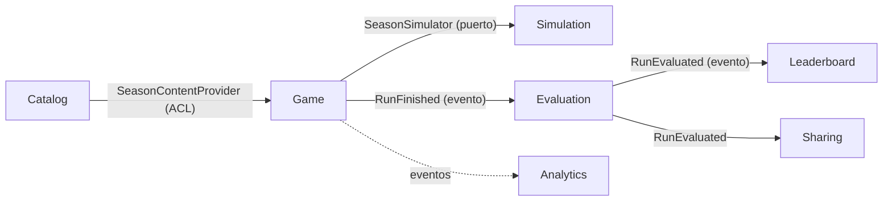

# ADR-003 · Contextos delimitados y mapa de contextos

- **Estado:** Aceptada
- **Fecha:** 2026-10-22
- **Relacionado con:** [PLAN](../PLAN.md) §1, §2 (P2 y P6) y §3.1 · [ADR-002](./002-arquitectura-hexagonal.md) · ADR-015 · [glosario](../glossary.md)

## Contexto

El juego mezcla problemas de naturaleza muy distinta:

- **Datos históricos** que se editan a mano, se verifican con fuentes y son de solo lectura durante una partida.
- **Un motor de simulación** matemático y determinista, que se calibra con Monte Carlo y no debería saber qué es un dilema.
- **Las reglas de una partida**: decisiones, efectos, moral, directiva, destitución y fichajes.
- **La evaluación** final frente a la historia, que es lo que se comparte.
- **Piezas de soporte** (ranking, tarjeta OG, analítica) con requisitos propios de rendimiento, caché y privacidad.

Si todo comparte un único modelo, cada cambio arrastra a los demás: un campo nuevo en el YAML obliga a tocar el motor, y una regla de la directiva acaba importando tablas del ranking. Además, el trabajo se reparte entre agentes en paralelo (PLAN §6), que necesitan fronteras claras para no pisarse.

Hay dos tensiones de modelado concretas:

1. **El mismo club-temporada es a la vez el equipo propio y un rival.** El Atlético 2012-13 es rival del Real Madrid 2012-13, y más adelante puede ser jugable. Los rivales tienen plantilla real desde la V1 (PLAN §1), y fichar a un jugador de un rival debe sacarlo de su plantilla dentro de tu partida.
2. **Simular toda la liga** exigiría el calendario completo de 20 equipos por temporada y multiplicaría el trabajo de contenido, que ya es el riesgo principal (brief §13).

## Decisión

Siete contextos delimitados, cada uno con su paquete en `backend/src/mister/<contexto>/`:

| Contexto | Tipo | Responsabilidad |
|---|---|---|
| **Catalog** | Soporte | Contenido histórico versionado (clubes, `ClubSeason`, `PlayableSeason`, plantillas, calendario, dilemas, textos, historia real). Solo lectura en juego. |
| **Simulation** | **Núcleo** | Partidos, competiciones y bloques, de forma determinista a partir de una semilla. Sin IO. |
| **Game** | **Núcleo** | El agregado `Run`: decisiones, efectos, moral, estado físico, directiva, destitución y `SquadRegistry`. |
| **Evaluation** | Núcleo | `MisterScore`, comparación con la historia y `Verdict`. |
| **Leaderboard** | Soporte | Ranking por temporada con alias y percentiles. |
| **Sharing** | Soporte | Tarjeta OG y página pública `/r/<id>`. |
| **Analytics** | Genérico | Eventos de producto sin cookies. |

**Regla de integración** (PLAN §3.2, regla 4; [ADR-002](./002-arquitectura-hexagonal.md)): un contexto solo puede importar de otro su API publicada, `<contexto>/application/api.py` (DTOs y fachada), y siempre desde un adaptador de su propia `infrastructure`. Nunca su `domain`.

Lo que se comparte de verdad entre todos (IDs tipados, `Seed`, `RandomSource`, `Clock`, `DomainError`, `DomainEvent`, `EventBus`) va en un **shared kernel** pequeño y estable.

**Mapa de contextos:**

- **Catalog → Game (*published language* + ACL):** Catalog publica el contenido como DTOs de solo lectura en su API publicada (`catalog/application/api.py`). Game los consume a través del puerto `SeasonContentProvider`, desde un adaptador de `game/infrastructure` que los traduce a su propio modelo. Game no conoce el YAML, ni las tablas, ni el dominio del catálogo.
- **Game → Simulation (cliente/proveedor):** Game depende del puerto `SeasonSimulator`; su adaptador (`game/infrastructure/simulation_adapter.py`) traduce `RunState` a los DTOs de la API publicada del motor (`simulation/application/api.py`: `SeasonSimInput`, `BlockSimRequest`, `BlockSummaryDTO` y la fachada `SimulationService`). Nunca importa `simulation.domain` (`SimTeam`, `Tactic`… son internos del motor). El motor no sabe nada de partidas, dilemas ni HTTP.
- **Game → Evaluation → Leaderboard / Sharing (eventos):** al terminar una partida, Game publica `RunFinished`; Evaluation calcula la puntuación y publica `RunEvaluated`, que consumen Leaderboard y Sharing. En la V1 el bus es **síncrono y en proceso**.
- **Game → Analytics (eventos):** Analytics escucha eventos y nunca influye en el juego.

**`ClubSeason` frente a `PlayableSeason`** (desarrollado en el ADR-015): la plantilla pertenece al `ClubSeason`, el mismo modelo para tu equipo y para los rivales. Un `PlayableSeason` es un `ClubSeason` al que se añaden entrenador real, competiciones, dilemas, objetivos e historia real. Dentro de una partida, la plantilla efectiva de cualquier club-season es **la del contenido más las diferencias guardadas en `SquadRegistry`** (fichajes y ventas, tuyos y de los rivales), que vive en Game. Es la base del mercado de fichajes futuro y permite que cualquier rival sea jugable más adelante sin rehacer datos.

**Resultados de los partidos ajenos (P2):** los partidos que no te involucran no se simulan; se usan los resultados históricos. La política va detrás del puerto **`ExternalResultsPolicy`** en Simulation, con el adaptador `HistoricalExternalResults` en la V1 (puntos de un rival = reales − los que sacó contra ti en la realidad + los que saca contra ti en la simulación; en eliminatorias, el cuadro real). Cuando exista un mercado completo se podrá añadir `SimulatedExternalResults`, que simulará todos los partidos con las plantillas rivales, sin cambiar Game.

## Alternativas consideradas

- **Un único modelo compartido (el esbozo del brief §12 con `TeamSeason`).** Es más simple al principio, pero mezcla el contenido con el estado de la partida y hace imposible que un rival sea a la vez dato de solo lectura y plantilla modificada dentro de una partida.
- **Plantilla dentro de la temporada jugable (`content/seasons/<slug>/squad.yaml`).** Duplicaría las plantillas cuando un rival también sea jugable y no permitiría fichar de un rival de forma coherente. Se descarta en favor de `ClubSeason`.
- **Rivales solo con fuerza agregada (P1).** Reduce mucho el contenido, pero quita el mercado entre plantillas reales y el debate de fichar a la estrella de un rival directo. Se descartó; la fuerza agregada queda solo para los rivales de fuera de Primera.
- **Simular la liga completa desde la V1.** Más fiel a "lo que podría haber pasado", pero exige el calendario de todos los equipos y que la calibración de 20 plantillas sea buena a la vez. P2 mantiene "la historia real es el rival" con muchos menos datos, y el puerto deja la puerta abierta.
- **Fusionar Evaluation dentro de Game.** Ahorra un contexto, pero la puntuación y el veredicto cambian por motivos de producto (pesos, frases), no por reglas de la partida, y tienen sus propios tests de mutación.
- **Bus de mensajes asíncrono (colas) desde la V1.** Añade infraestructura y consistencia eventual sin necesidad con un único proceso. El puerto `EventBus` permite cambiarlo si hace falta.

## Consecuencias

- **Positivas:**
  - Cada contexto evoluciona por su motivo: el motor se recalibra sin tocar la partida; el formato del contenido cambia sin tocar el motor.
  - Las fronteras coinciden con la propiedad de ficheros de `TASKS.md`, lo que permite oleadas de agentes en paralelo.
  - `ClubSeason` y `SquadRegistry` preparan el mercado de fichajes y nuevas temporadas jugables sin migraciones de contenido.
  - P2 reduce drásticamente los datos necesarios: basta la clasificación real en las fechas de corte y los resultados de tu equipo.
- **Negativas y trade-offs:**
  - Más traducciones entre modelos (ACL, adaptador del simulador) y más DTOs.
  - Con P2, en la V1 fichar a un jugador de un rival solo lo debilita **en sus partidos contra ti**; el resto de sus resultados siguen siendo los históricos. Es una simplificación consciente que hay que explicar si alguien la detecta.
  - El bus síncrono hace que un fallo en un manejador (por ejemplo, el ranking) pueda afectar al cierre de la partida; los casos de uso tienen que delimitar bien la unidad de trabajo.
  - La API publicada de cada contexto (`application/api.py`) es un contrato: cambiarla requiere una tarea CR, y sus DTOs duplican parte de los VOs internos a cambio de poder cambiar el dominio sin romper a los consumidores.
- **Seguimiento:** si el mercado completo o el calendario de liga entero entran en el alcance, se añade `SimulatedExternalResults` y se revisa este ADR.
